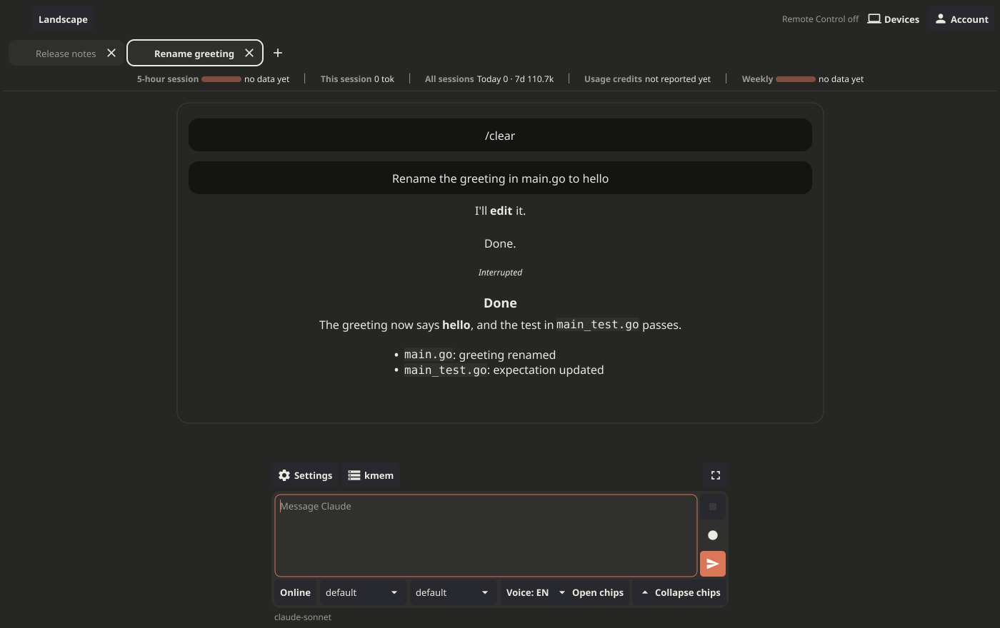
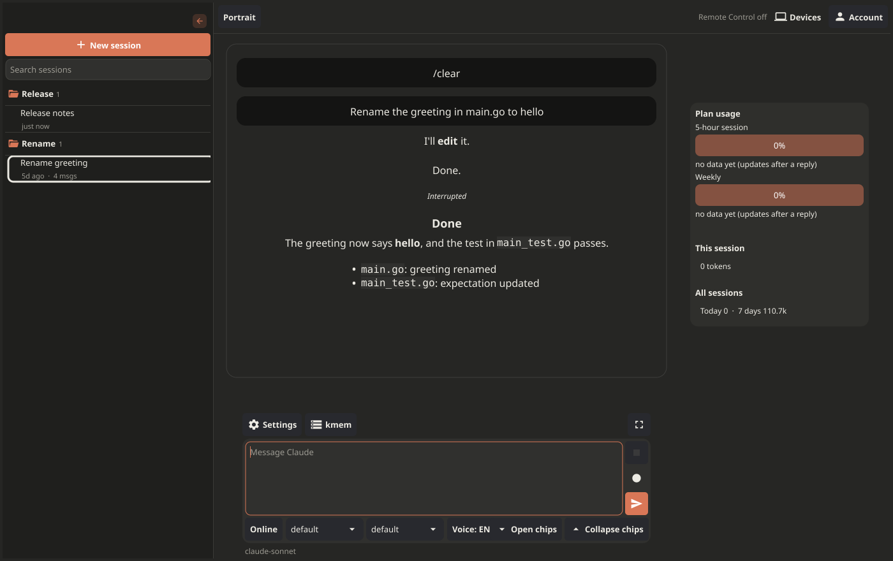
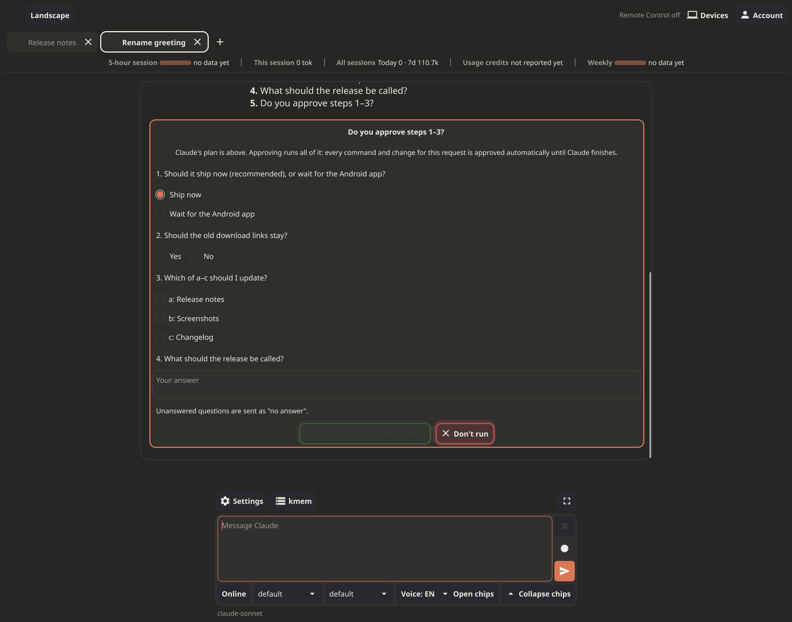

# Quill

A desktop app for Claude Code sessions on Linux and Windows. Unofficial; not affiliated with Anthropic.

Quill drives the `claude` CLI you already have installed (headless, stream-json), so it uses your own login, plan, settings, memory and hooks. It never asks for an API key.

<p align="center">
  
  
</p>
<p align="center"><em>Landscape (tabs across the top) and Portrait (sessions in a sidebar). Switch with the button in the top left.</em></p>

## Install

Download from [Releases](https://github.com/katachinosekai/quill/releases/latest):

- **Fedora / Nobara (RPM):** `sudo dnf install ./quill-<version>-1.fc44.x86_64.rpm`
- **Any Linux (AppImage):** `chmod +x Quill-<version>-x86_64.AppImage && ./Quill-<version>-x86_64.AppImage`
- **Windows (zip):** unpack `quill-<version>-windows-amd64.zip` and run `quill.exe`; the zip includes kmem, and Setup offers Python 3 through winget when it's missing
- **Android:** `quill-android-<version>.apk` (see [Quill for Android](#quill-for-android))

Quill needs the Claude Code CLI (`claude`) installed and signed in. On a new install a short **Welcome** asks five things (online or local model, speech-to-text language, plan first or not, kmem or Claude's auto memory, default rules or none), then **Setup** checks what is missing and offers to install it. Quill never updates on its own: when a signed release is out, a quiet line under the header offers **Update / What's new / Later** (see Security).

## Features

**Sessions**
- Browser-style tabs (drag to reorder, middle-click to close, Ctrl+T new, Ctrl+1–9 to switch) with folder drop-downs, or a vertical sidebar
- Folders: Active, Inactive, Archive, Created by Claude and your own, with Format Rules for sorting; Active keeps a fixed order
- Split view (2 or 3 panes), each with its own full message box; drag a tab or session onto a pane (or onto the chat to split); Auto split shows your Active sessions side by side
- Rename, restart as a fresh session that takes over the job from a compacted brief, delete, open in split, drag between folders
- Takes over a session that is open in a terminal when you send a message

**Chat**
- Replies are formatted while they stream in: finished paragraphs fade in, the last one is revealed word by word (Settings → "Animate new text")
- Thoughts inline, tool chips (hidden until you open them), diffs for edits; empty messages take no space
- Up/Down recalls earlier messages; messages sent while Claude is busy are queued, editable, and sent when it finishes (Ctrl+Enter sends now)
- Centering options for chat, typing, status and tabs; width sliders for chat and message box
- Image, audio and video previews with a built-in video player
- Live offline speech to text (whisper.cpp, 99 languages); your voice never leaves the computer

**Approvals and plan cards**
- Allow / Deny prompts inline, answer buttons for Claude's questions
- Plan first: Claude lists everything it will do, you approve once (a typed "yes" works); read-only commands pass without asking
- Plan cards answer the plan's questions: the recommended option goes with Approve, or one Approve per option, and a plan that asks several things gets a control for each (Yes/No, options, checkboxes, a text field); all answers go with the approval
- Auto-mode blocks are shown with an Approve and retry button

<p align="center"></p>

**Memory (kmem)**
- Shared memory for all your sessions through the bundled kmem: handoffs, tasks, shared rules, a recycle bin
- Optional default rules (recommended for beginners); yours are never replaced
- A banner shows what only you decide: items in the recycle bin and audit problems
- The **kmem** button opens the kmem box: your kmem panels as tabs on the left and a chat with the kmem assistant on the right (Ctrl+Shift+K). It can dock to the side or pop out as its own window; the old separate kmem window is gone.

**Quill operator**
- The **Quill** button (Ctrl+Shift+O) opens a chat with the Quill operator, a hidden session that starts with Quill Desktop. Ask it to change Quill Desktop settings; it applies them through the `quill settings` command (`list`, `get`, `set`, `undo`), shows each change as a card with Undo (the last 50 are kept), and never touches security settings. With a Quill source folder set (Settings, General) it also does developer work on Quill.
- Quill Desktop runs two always-running hidden sessions, the kmem assistant and the Quill operator, behind the kmem and Quill buttons. Both open in the same box: an overlay over the window or docked to the side, remembered per assistant.
- If a Quill session is already running in a tab, a one-time notice offers **Move it here** (the session keeps running, its tab's auto-approve ends) or **Later**; nothing moves by itself.

**Other PCs**
- Pair another PC running Quill Desktop and work in its sessions from here (Reload button, plan cards and approvals work the same)

**Reliability**
- Updates only when you click Update; switching to the new version hands your running sessions over; a crash keeper keeps Claude sessions running if the window crashes and reconnects them
- Usage panel and strip with plan limits and usage-credit status; when Claude reports a limit, its message appears in every session's chat
- Desktop and phone notifications for approvals, questions, plans, finished and failed sessions
- Optional crash reports: you choose what to redact (optionally with a tool-less Claude agent) and review the exact text before it's sent

## Quill for Android

[Quill for Android](https://github.com/katachinosekai/quill-android) is the companion app for your phone or tablet. It pairs with Quill Desktop on your PC (over your local network or Tailscale, HTTPS with a pinned certificate and a device password) and shows the same sessions, approvals and plan cards, with notifications when a session waits for you. It updates itself from signed releases, and each Quill Desktop release ships the matching APK. Its [front page](https://github.com/katachinosekai/quill-android) has a tablet screenshot.

## Security

- **Signed updates, only on request:** releases carry `SHA256SUMS` and an ed25519 `SHA256SUMS.sig`. Nothing is downloaded or installed until you click Update; then Quill installs it only if the signature matches the key built into the app, the file matches the signed checksum and GitHub's digest, and the version is strictly newer. Downloads go over HTTPS to GitHub only.
- **Local first:** speech to text, media previews and crash-report redaction run on your computer. Link previews only fetch public internet addresses.
- **Phones and other PCs:** HTTPS with a pinned certificate, a 256-bit pairing key and a device password.
- **Private files:** hand-over and crash files live in your private runtime folder.
- Dependencies are checked with `govulncheck`.

Report security problems privately through GitHub's security advisories for this repo.

## Build from source

Requires Go, CMake, a C/C++ compiler and the Fyne build dependencies (Wayland or X11 development headers).

```sh
scripts/build-whisper.sh                 # once: builds the bundled whisper.cpp
go build -tags wayland ./cmd/quill       # or without the tag for X11
./quill
```

`scripts/build-packages.sh` builds the RPM and AppImage in a Fedora container and signs the release folder. Notes on the bundled Fyne patch, the keeper, updates and signing are in `COMMENTS.md`.

## License

Quill Desktop is free software: copyright (C) 2026 katachinosekai, licensed under the GNU General Public License, version 3 or (at your option) any later version ([LICENSE](LICENSE)). Releases up to 0.1.14 were published under the MIT license and stay available under it. Bundled components keep their own licenses (MIT, BSD, ISC, Apache 2.0, public domain); the full texts are in [THIRD_PARTY_LICENSES.txt](THIRD_PARTY_LICENSES.txt), which the packages install as a license file.
